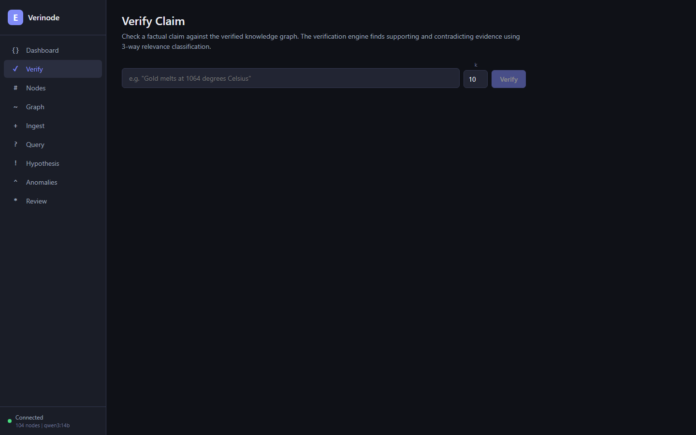
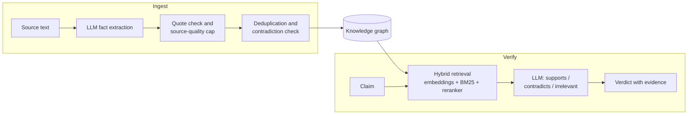
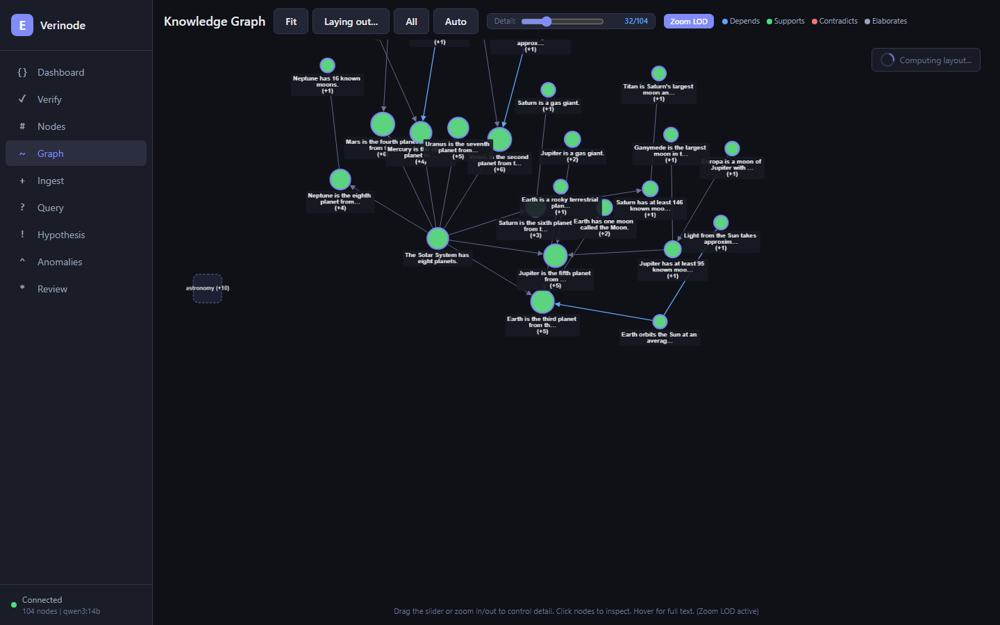

# Verinode

[](https://github.com/Delta025/verinode/actions/workflows/ci.yml)
[](LICENSE)


**A knowledge graph that checks LLM claims against sourced, confidence-scored facts.**

LLMs store what they know in opaque weights, so they cannot say where a fact came from, how sure they are, or notice when their context has been poisoned. Verinode keeps knowledge outside the model, in an explicit graph where every fact has a source, a confidence score and links to the facts it depends on. Claims are verified against that graph and come back as **supported**, **contradicted** or **insufficient evidence**, with the evidence attached.



## How it works



- **Ingestion** extracts atomic facts from text, checks each one against its source passage, merges duplicates, flags conflicts with existing knowledge and links dependent facts.
- **Confidence** comes from source quality, independent corroboration and inference depth, and propagates through dependency edges. Facts decay when they go unused or rest on a single source.
- **Verification** retrieves candidate facts and asks an LLM only a narrow question: does this fact support, contradict, or not concern the claim? The verdict is aggregated from the graph's own confidence scores.

## Project status

Verinode is a personal research prototype built in 2026. It works end to end, but it is not under active development.

| | |
|---|---|
| **Works** | Graph model with provenance, confidence propagation and JSON/SQLite storage · ingestion pipeline · claim verification · CLI (21 commands) · REST API · React web UI · 797 passing unit tests |
| **LLM backends** | Gemini (verified end to end with `gemini-3.8-flash`, Oct 2026) and Ollama (`qwen3:14b`, used for all benchmarks, not re-tested since Feb 2026) |
| **Limitations** | Ingestion and verification need an LLM; browsing a graph does not. Claims about topics the graph doesn't cover return *insufficient evidence*. A consistent set of false facts, if ingested as trusted, will be believed. Near-miss numbers (rounding) can slip through. Retrieval is the bottleneck: the full pipeline flags 48% of contradictions versus 80% when the LLM is shown the right pair directly. |
| **Not included** | Authentication or multi-user support · PyPI package. A `Dockerfile` and `docker-compose.yml` are included but were not tested for this release. |

## Quick start

Requires Python 3.10+. Node.js is only needed to build the web UI.

```bash
git clone https://github.com/Delta025/verinode.git
cd verinode
pip install -e ".[gemini]"

# Build the web UI (one time)
cd src/web && npm ci && npm run build && cd ../..
```

Pick an LLM backend:

```bash
# Option A: Gemini (fast, needs an API key)
export VERINODE_GEMINI_API_KEY=your-key
export VERINODE_CHECKER_BACKEND=gemini
export VERINODE_EXTRACTOR_BACKEND=gemini

# Option B: Ollama (local, needs a GPU with ~10 GB of memory)
ollama pull qwen3:14b
```

Launch the web UI with the bundled 104-fact solar system graph and open http://localhost:8000:

```bash
python demos/run_demo.py
```

Or use the CLI:

```bash
verinode --graph data/demo_graph.json stats
verinode --graph data/demo_graph.json verify "Jupiter has only 12 moons."
verinode --graph my_graph.db ingest "Water boils at 100 degrees Celsius at sea level." --domain chemistry
verinode --help
```

All settings are listed in [.env.example](.env.example).

## Python API

```python
from src.core.fact_extraction import create_fact_extractor
from src.core.graph import KnowledgeGraph
from src.core.llm_contradiction import create_contradiction_checker
from src.core.node import Source
from src.core.pipeline import Pipeline
from src.core.verification import VerificationEngine

graph = KnowledgeGraph()
checker = create_contradiction_checker()  # backend chosen from the environment
pipeline = Pipeline(graph, extractor=create_fact_extractor(), contradiction_checker=checker)

source = Source(source_type="encyclopedia", title="Planetary fact sheet", quality_score=0.9)
pipeline.ingest("Mars has two moons, Phobos and Deimos. A Martian day lasts about 24.6 hours.",
                source=source, domain="astronomy")

verifier = VerificationEngine(graph, embedding_engine=pipeline.embedding_engine, contradiction_checker=checker)
result = verifier.verify("Mars has three moons.")
print(result.verdict.value, result.confidence)  # contradicted 0.92
```

See the [Python API guide](docs/python-api.md) for each module.

## Results

The headline experiment gives the same model, `qwen3:14b`, 75 test cases with and without Verinode. In the poisoning cases, false "reference material" is injected into the model's context.

| Category | LLM alone | LLM + Verinode |
|---|:---:|:---:|
| Factual accuracy (15) | 100% | 100% |
| False claim detection (20) | 100% | 95% |
| **Poisoned context resistance (15)** | 20% | **100%** |
| **Subtle numerical errors (15)** | 20% | **80%** |

On a separate set of 20 claims, verification caught 9 of 10 false claims and confirmed 9 of 10 true ones. These are small, single-model experiments on general-science facts, so treat them as evidence the approach works, not as a measured accuracy. Methodology, the other benchmarks and their caveats are in [docs/benchmarks.md](docs/benchmarks.md).

The [AI poisoning notebook](demos/ai_poisoning/ai_poisoning_demo.ipynb) walks through the same scenario with Gemini: poison an LLM's context, build a small trusted graph, then catch the poisoned claims.



## Repository layout

```
src/core/     graph, confidence, ingestion pipeline, retrieval, verification
src/cli/      `verinode` command-line interface
src/api/      FastAPI server (`verinode-server`)
src/web/      React + Cytoscape.js web UI
tests/        unit tests (integration and calibration suites are opt-in)
benchmarks/   vulnerability benchmark, stress tests and calibration scripts
demos/        AI poisoning notebook and web UI demo launcher
examples/     short standalone examples
docs/         architecture, Python API, benchmarks, research notes
```

## Development

```bash
pip install -e ".[dev,gemini]"
pytest                                   # unit tests, no LLM needed
pytest --run-integration -m integration  # needs a running Ollama server
ruff check src tests && ruff format --check src tests
```

The frontend dev server (`cd src/web && npm run dev`) runs on port 5173 and proxies API calls to `uvicorn src.api.main:app --reload` on port 8000.

## Further reading

- [Architecture](docs/architecture.md): modules, data model and algorithms
- [Benchmarks](docs/benchmarks.md): every experiment, with methodology and caveats
- [Research notes](docs/research.md): the AI-safety motivation and related work
- [Roadmap](ROADMAP.md): directions the project could take next

## License

[MIT](LICENSE) © 2026 Simon Lesperance. The dataset subsets in [data/calibration](data/calibration/README.md) keep their original licenses.
